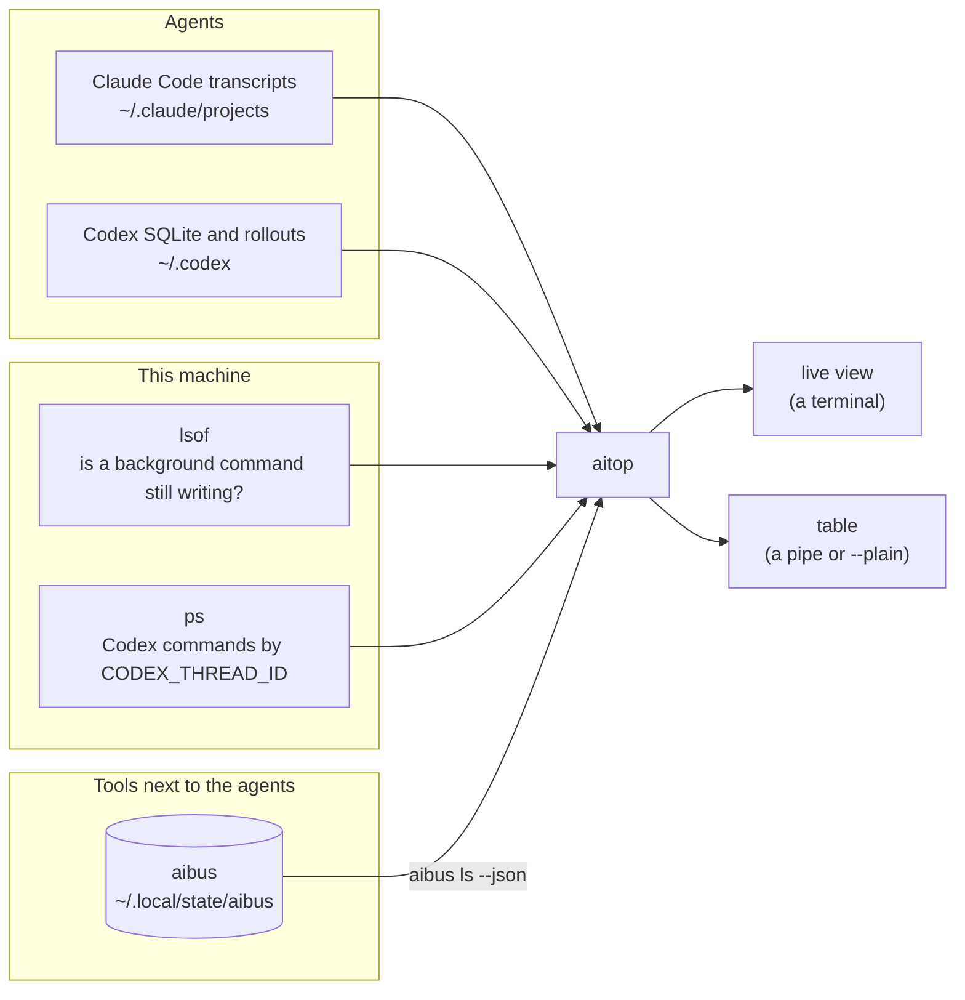

<div align="center">

# aitop

**A live view of what Claude Code and Codex are running on this machine**

Sessions, workflows, subagents and background shell commands in one screen, refreshed every second.<br>
Read-only: it never starts, resumes or stops anything.

[](#install)
[](aitop)
[](LICENSE)

</div>

```
 aitop                                                           claude+codex   all projects   14:32:07
  STATE             NOW                        UPTIME     LAST        AI      NAME / TITLE
 MCP
▶ ● running                                    1h12m                  aibus   wiki MCP
 Background Tasks
  ● running         [3/4] codex exec in pyth…  2m10s      now         claude  verify the linter
 mac
  ! warn            swap 4970/6144M pressure…             2m00s ago   aibus   mac-slow-log
 xverify
  ● running         reproducing finding 3 in…  2m02s      2s ago      aibus   webapp 3f2a91c
 Sessions
  ○ recent-output                                         12s ago     claude  status router
  ◐ in-progress                                           40s ago     codex   review aibus

 ↑↓ move  ⏎ details  l hidden  a AI  / search  q quit                                           6 shown
```

## How it works

aitop only reads what is already on disk and in the process table. Claude Code and Codex keep their own records, so aitop reads those directly. Everything else that runs next to the agents (MCP servers, verifiers, scheduled checks) reports itself on [aibus](https://github.com/dor1a/aibus), and aitop shows each aibus source as its own group.



| Source | What aitop shows |
| -- | -- |
| Claude Code transcripts | Sessions, workflows, subagents and the shell commands they ran in the background |
| Codex SQLite and rollouts | Sessions and stored command records |
| `lsof`, `ps` | Whether a Claude background command is still writing, and which Codex commands run now |
| `aibus ls --json` | One group per source, `mcp` on top and the rest after the background tasks, with `aibus` in the `AI` column |

A transcript is parsed again only when its size or modification time changes, so finished sessions and agents cost almost nothing between passes.

## Install

Python 3.9 or later on macOS or Linux, standard library only.

```sh
git clone https://github.com/dor1a/aitop.git
cd aitop
./install.sh
```

`install.sh` links `aitop` into `~/.local/bin`. To update, `git pull` in the clone.

`lsof` and `ps` are optional: without them a Claude background command shows as `unknown` and live Codex commands are not listed. [aibus](https://github.com/dor1a/aibus) is optional too; without it there are simply no aibus groups.

## Usage

In a terminal, `aitop` opens the live view. Rows are grouped, each with a colored state, the last line it printed (`NOW`) and a details pane for the selected row.

| Key | Action |
| -- | -- |
| ↑ ↓, `j` `k` or the mouse wheel | Move the selection |
| Click | Select a row |
| Enter or double click | Open or close details |
| `l` | Show or hide ended records |
| `a` | Switch between both AIs, Claude and Codex |
| `/` | Search titles and IDs; Esc clears the search |
| `q` | Quit |

While the view runs it takes the mouse, so selecting text needs the terminal's override: hold Option while dragging in iTerm2, or turn off View > Allow Mouse Reporting in Terminal.app.

When the output is not a terminal, or with `--plain`, the table is printed instead, so pipes and an agent's own shell get plain text:

```sh
aitop                     # live view
aitop --plain -a          # table: both AIs, every record kind, every project
aitop --plain -al         # the same, including ended records
aitop --plain --kind mcp  # only what aibus lists under mcp
```

| Option | Effect |
| -- | -- |
| `-a` | Both AIs, every kind, every project, plus aibus entries |
| `--ai claude\|codex\|both` | One AI. The scope stays on the nearest recorded project unless `--all-projects` widens it |
| `--kind KIND` | `session`, `workflow`, `agent`, `task`, `bg-task`, or an aibus source such as `mcp` |
| `-l` | Include completed, stopped, failed and archived records |
| `-v` | Add model, task and parent IDs to the table |

`CLAUDE_CONFIG_DIR` and `CODEX_HOME` select custom profiles. `aitop --help` lists every column and state.

## Showing your own tools

Anything that reports on aibus appears in aitop with no change to aitop:

```sh
aibus put backup nightly --title "nightly backup" --ai cron --pid $$
```

| aibus field | aitop column |
| -- | -- |
| `source` | The group name. `mcp` is pinned to the top |
| `ai` | The details pane. The `AI` column shows `aibus`, and `a` and `--ai` still filter by this field |
| `status` | `STATE`, with `exit_code` in parentheses |
| `now` | `NOW` |
| `progress` | `PROGRESS` in the table, `N/M` in the details |
| `started` | `UPTIME`, while the entry has a live process or is running |
| `updated` | `LAST` |
| `links`, `host` | The details pane |

An entry whose process ended without reporting shows as `gone` and stays in view, and a scheduled job that missed two runs shows as `late`. Finished and failed entries join the ended records that `l` shows.

aitop reads with `aibus ls --json --reader aitop`, so `aibus status` shows when aitop last read. If a tool reports but aitop shows nothing, that line tells whether aitop is reading at all.

## What the rows mean

| State | Meaning |
| -- | -- |
| `running` | A live process: a Claude output writer, a Codex command with its thread ID, or an aibus entry |
| `in-progress` | Recorded as running. Not a live process check; after four minutes without updates it becomes `unknown` |
| `recent-output` | Recent transcript activity, not proof of a running process |
| `unknown` | Needs checking, and stays visible regardless of age |
| `turn-complete` | The last turn ended. Not proof that the whole task succeeded |
| `finished`, `failed` | A subagent handed its result back, or a command exited with code 0 or non-zero |
| `ok`, `warn`, `late`, `gone` | From aibus: what a tool reported, a missed schedule, a process that ended without reporting |

For Claude, a shell command is listed only when the transcript reports it as a background command, and its output file's end marker supplies the exit code. `PROGRESS` and `LEFT` come from the last `[n/m]` at the start of a line or `n%` at the end of one. For Codex, `ps` finds command roots under a Codex process by `CODEX_THREAD_ID`; `-l` adds the latest 200 stored command records per thread.

Titles use command descriptions and program names, never arguments or output. The details pane shows the full command, up to five lines; the environment that names a Codex thread is never shown.

## Checks

The tests use only the standard library. Some need Linux `ps` and `lsof`, so run them in a container to get all of them:

```sh
docker run --rm -v "$PWD:/w:ro" -w /w -e PYTHONDONTWRITEBYTECODE=1 python:3.14-slim \
  sh -c 'apt-get -qq update && apt-get -qq install -y procps lsof >/dev/null && python -m unittest discover -s tests'
```

## License

[MIT](LICENSE)

Public tools with the same name exist; this one is unrelated to them.
