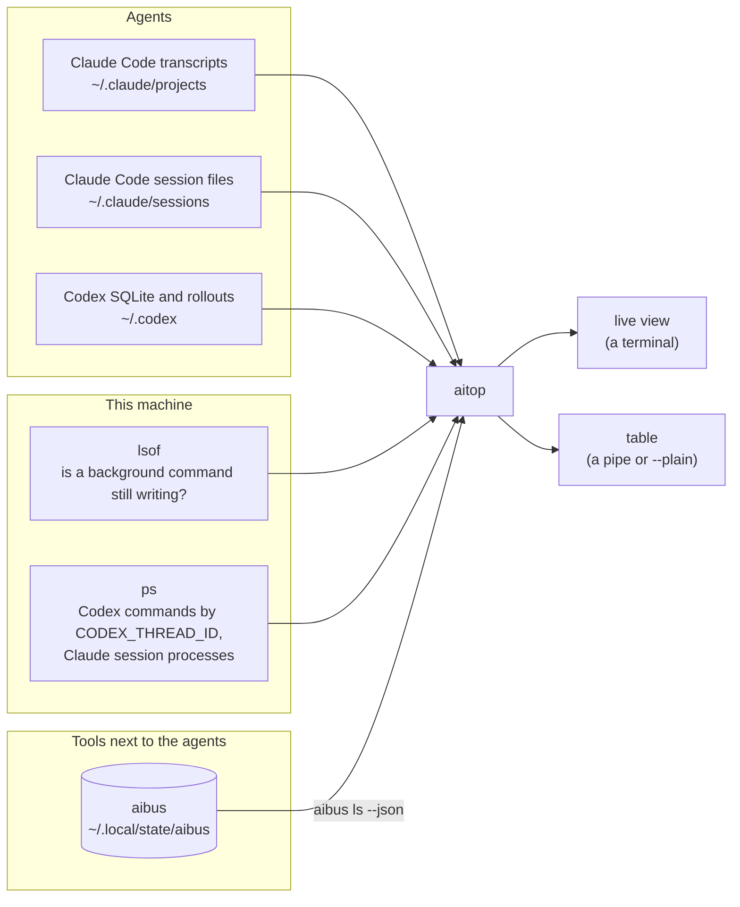

<div align="center">


# aitop

**A live view of what Claude Code and Codex are running on this machine**

Sessions, workflows, subagents, background shell commands and scheduled jobs in one screen, refreshed every second.<br>
Read-only: it never starts, resumes or stops anything.

[](#install)
[](aitop)
[](LICENSE)

</div>

```
 aitop                                                           claude+codex   all projects   14:32:07
  STATE             NOW                        UPTIME     LAST(LEFT)  AI      NAME / TITLE
 MCP
▶ ● running                                    1h12m                  aibus   wiki MCP
 mac
  ! warn            swap 4970/6144M pressure…             2m00s ago   aibus   mac-slow-log
 xverify
  ● running         reproducing finding 3 in…  2m02s      2s ago      aibus   webapp 3f2a91c
 Background Tasks
  ● running         [3/4] codex exec in pyth…  2m10s      now         claude  verify the linter
 Sessions
  ○ recent-output                                         12s ago     claude  status router
  ◐ in-progress                                           40s ago     codex   review aibus

 ↑↓ move  ⏎ details  l show 14 hidden  a AI  / search  q quit                                   6 shown
```

## Install

macOS, with Homebrew:

```sh
brew install dor1a/tap/aitop
```

Linux and WSL, from a clone:

```sh
git clone https://github.com/dor1a/aitop.git
cd aitop
./install.sh
```

`install.sh` links `aitop` into `~/.local/bin` and says so when that folder is not on your `PATH`. If it is not, add it in your shell's rc file:

```sh
export PATH="$HOME/.local/bin:$PATH"
```

To update, run `brew upgrade aitop`, or `git pull` in the clone.

aitop needs Python 3.9 or later and uses only the standard library, so the macOS `/usr/bin/python3` is enough.

`lsof` and `ps` are optional: without them a Claude background command shows as `unknown`, live Codex commands are not listed, and Claude scheduled jobs do not show. [aibus](https://github.com/dor1a/aibus) is optional too; without it there are simply no aibus groups.

## Usage

In a terminal, `aitop` opens the live view. Rows are grouped, each with a colored state, `NOW` (the last line it printed, or for a Claude subagent its latest tool call) and a details pane for the selected row. The live view reads both AIs and every project; `--ai`, `--kind` and `-l` only set what it shows first.

| Key | Action |
| -- | -- |
| ↑ ↓, `j` `k` or the mouse wheel | Move the selection |
| Page Up, Page Down | Move a screen at a time |
| Home, End | Go to the first or last row |
| Click | Select a row |
| Enter or double click | Open or close details |
| Space | Mark or unmark the selected row. Several rows can be marked |
| `l` | Show or hide hidden records from the last 24 hours. The key bar says how many there are |
| `a` | Switch between both AIs, Claude and Codex |
| `/` | Search titles and IDs. Esc while typing cancels the edit; Esc afterwards clears the search, and Esc with no search clears the marks |
| `q` | Quit |

While the view runs, the marked rows are written to `~/.local/state/aitop/marked.json` (`AITOP_MARKS_FILE` overrides it): the record's AI, kind, ID, state, title, project and command, without the output that changes every second. The file goes when the marks are cleared or the view quits. A prompt hook can read it and tell the agent which rows the next message is about.

While the view runs it takes the mouse, so selecting text needs the terminal's override: hold Option while dragging in iTerm2, or turn off View > Allow Mouse Reporting in Terminal.app.

When the output is not a terminal, or with `--plain`, the table is printed instead, so pipes and an agent's own shell get plain text:

```sh
aitop                     # live view
aitop --plain -a          # table: both AIs, every record kind, every project
aitop --plain -al         # the same, including ended records
aitop --plain --kind mcp  # only what aibus lists under mcp
```

| Option | Effect |
| -- | -- |
| `-a` | Both AIs, every kind, every project, plus aibus entries |
| `--ai claude\|codex\|both` | One AI. In the table, the scope stays on the nearest recorded project unless `--all-projects` widens it |
| `--kind KIND` | `session`, `workflow`, `agent`, `task`, `bg-task`, `schedule`, or an aibus source such as `mcp` |
| `-l` | Include completed, stopped, failed and archived records, and aibus entries that last reported `ok`. These are listed for 24 hours after their last update |
| `-v` | Add model, task and parent IDs to the table |

`CLAUDE_CONFIG_DIR` and `CODEX_HOME` select custom profiles. `aitop --help` lists every column and state.

### Showing your own tools

Anything that reports on aibus appears in aitop with no change to aitop:

```sh
aibus put backup nightly --title "nightly backup" --ai cron --pid $$
```

| aibus field | aitop column |
| -- | -- |
| `source` | The group name. aibus groups sit above Claude and Codex work, `mcp` first |
| `ai` | The details pane. The `AI` column shows `aibus`, and `a` and `--ai` still filter by this field |
| `status` | `STATE`, with `exit_code` in parentheses |
| `now` | `NOW` |
| `progress` | `PROGRESS` in the table, `N/M` in the details |
| `started` | `UPTIME`, while the entry has a live process or is running |
| `updated` | `LAST(LEFT)` |
| `links`, `host` | The details pane |

An entry whose process ended without reporting shows as `gone` and stays in view, and a scheduled job that missed two runs shows as `late`. Finished and failed entries join the ended records that `l` shows, and so does an entry whose last report was `ok`: a scheduled check that is fine has nothing to say until it turns `warn` or `late`.

aitop reads with `aibus ls --json --reader aitop`, so `aibus status` shows when aitop last read. If a tool reports but aitop shows nothing, that line tells whether aitop is reading at all.

### What the rows mean

| State | Meaning |
| -- | -- |
| `running` | A live process: a Claude output writer, a Codex command with its thread ID, or an aibus entry |
| `in-progress` | Recorded as running. Not a live process check; after four minutes without updates it becomes `unknown` |
| `recent-output` | Recent transcript activity, not proof of a running process |
| `unknown` | Needs checking, and stays visible regardless of age |
| `turn-complete` | The last turn ended. Not proof that the whole task succeeded |
| `finished`, `failed` | A subagent handed its result back, or a command exited with code 0 or non-zero |
| `ok`, `warn`, `late`, `gone` | From aibus: what a tool reported, a missed schedule, a process that ended without reporting |
| `scheduled`, `due` | A job a Claude session scheduled, before its time, or past it and waiting for the session to go idle |

For Claude, a shell command is listed when the transcript reports it as a background command, or while a foreground command is still running and writing its output file. The output file's end marker supplies the exit code. A `Monitor` watch is a background task too. Nothing holds its output file open, so it counts as running until its end marker or its deadline, and it shows from the call on, before its first event writes the file. `PROGRESS` and `LEFT` come from the last `[n/m]` at the start of a line or `n%` at the end of one. A job scheduled with `CronCreate` is listed under Scheduled while the Claude process that made it runs, since Claude Code keeps those jobs only in memory. aitop follows the `CronCreate`, `CronList` and `CronDelete` results in the transcript, and drops a one-shot job once its prompt comes back as a scheduled turn. For a job, `LEFT` is the time to its next run. The live view folds `LEFT` into `LAST(LEFT)`, which shows the time left instead (`12m00s left`) for a job, and for a command until it has printed nothing for a minute. For Codex, `ps` finds command roots under a Codex process by `CODEX_THREAD_ID`; `-l` adds the latest 20 stored command records per thread.

Titles use command descriptions and program names, never arguments or output. The details pane shows the full command, up to five lines; the environment that names a Codex thread is never shown.

## How it works

aitop only reads what is already on disk and in the process table. Claude Code and Codex keep their own records, so aitop reads those directly. Everything else that runs next to the agents (MCP servers, verifiers, scheduled checks) reports itself on [aibus](https://github.com/dor1a/aibus), and aitop shows each aibus source as its own group.



| Source | What aitop shows |
| -- | -- |
| Claude Code transcripts | Sessions, workflows, subagents, the shell commands they ran in the background, their `Monitor` watches, and the jobs they scheduled with `CronCreate` |
| Claude Code session files | Which Claude sessions still run, so their scheduled jobs show only while they do |
| Codex SQLite and rollouts | Sessions and stored command records |
| `lsof`, `ps` | Whether a Claude background command is still writing, whether a Claude session file still names a running process, and which Codex commands run now |
| `aibus ls --json` | One group per source, all above the Claude and Codex groups with `mcp` first, and `aibus` in the `AI` column |

A transcript is parsed again only when its size or modification time changes, so finished sessions and agents cost almost nothing between passes.

## Uninstall

```sh
brew uninstall aitop
```

For a clone, remove the link and then the clone:

```sh
rm ~/.local/bin/aitop
```

aitop writes no files of its own, so nothing else is left behind.

## Development

The tests use only the standard library. Some need Linux `ps` and `lsof`, so run them in a container to get all of them:

```sh
docker run --rm -v "$PWD:/w:ro" -w /w -e PYTHONDONTWRITEBYTECODE=1 python:3.14-slim \
  sh -c 'apt-get -qq update && apt-get -qq install -y procps lsof >/dev/null && python -m unittest discover -s tests'
```

## Not affiliated

aitop is a personal tool and is not affiliated with Anthropic or OpenAI. Public tools with the same name exist; this one is unrelated to them.

## License

[MIT](LICENSE)
